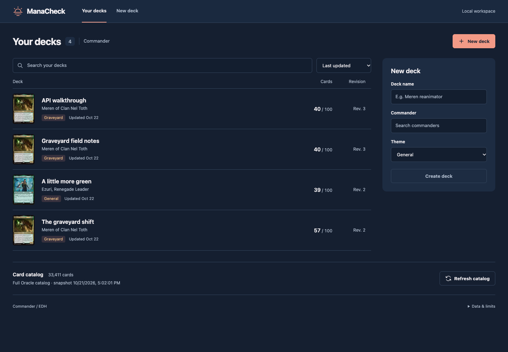
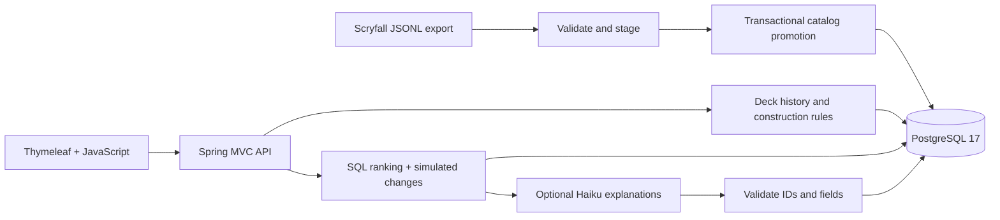

# ManaCheck

[](https://github.com/aali4356/ManaCheck/actions/workflows/verify.yml)

A local Commander deck tracker with immutable revision history, explicit SQL ranking, construction checks, and optional Haiku explanations. Built with Java 21, Spring Boot 4.1.1, PostgreSQL 17, Flyway, JDBC, and Thymeleaf.



The local verifier passes **130 checks**, including Cucumber scenarios, REST Assured contracts, PostgreSQL, Chrome, and role-tag regressions. CI and Jenkins use the same verifier; saved receipts identify their tested revision and inventory. Earlier ten-run stability samples passed locally and in Actions with 98 checks. The local catalog contains **34,473 cards**. The recorded walkthrough predates the sunset redesign; screenshots predate personal imports, and performance measurements used the earlier 33,411-card catalog. See [verification evidence](docs/VERIFICATION.md) and [role-tag limits](docs/ROLE-TAGGING.md).

## Run locally

Prerequisites: **JDK 21**, a running **Docker-compatible runtime with Compose v2**, and **Chrome** for browser tests. Maven is downloaded by the committed Maven Wrapper. The first build and container startup require network access to dependency registries.

```bash
./scripts/dev.sh
```

Open **http://localhost:8080**. The script starts only this project's Compose database. The database listens on `127.0.0.1:55432`; the application binds to `127.0.0.1`. Stop the application with Ctrl-C. Docker volume data persists between runs.

On this Mac, the script detects the installed Homebrew JDK and the dedicated `manacheck` Colima socket. It changes no shell defaults or active Docker context. On another machine, start Docker Desktop or your preferred compatible runtime and set `JAVA_HOME` to JDK 21.

For a manual start:

```bash
docker compose up -d --wait
./mvnw spring-boot:run
```

The first application start loads an offline sample and two unfinished decks. It never silently downloads the full catalog. **Load full catalog** starts a deliberate Scryfall import; imports preserve existing decks and old revisions. A fresh database can run the sample workflow without Scryfall or an AI provider. Card images are optional remote resources and can be unavailable offline.

## What works

- Create a deck around one commander; choose general, tokens, counters, or graveyard.
- Search local cards, edit quantities, and preview pasted `quantity card name` lists before replacing the working list.
- Save complete revision snapshots and compare additions, removals, quantities, and commander changes. Invalid or unfinished drafts remain saveable.
- Inspect construction findings, mana curve, color identity, and overlapping role coverage.
- Get up to five deterministic additions for unfinished decks or independently validated one-for-one swaps for complete decks.
- Apply one reviewed change to a new revision. Saved changes and catalog refreshes invalidate old recommendations.
- Request optional AI explanations; rule explanations remain available on missing credentials or provider failure.

See [API examples](docs/API.md), [SQL workbook](docs/sql-workbook.sql), [testing strategy](docs/TESTING.md), [measured query investigation](docs/PERFORMANCE.md), and [recorded five-minute walkthrough](docs/DEMO.md).

## Optional AI

```bash
export ANTHROPIC_API_KEY='your-key'
export ANTHROPIC_MODEL='claude-haiku-5-5'
./scripts/dev.sh
```

The application does not read `.env` automatically. `.env.example` lists supported settings without containing credentials. Keep keys out of Git and browser code.

Only **Explain with AI** calls the provider. It receives the commander, theme, deck count, and already selected changes, with a structured response schema, disabled thinking, a 1,200-token output cap, and a 10-second timeout. Each recommendation run permits one attempt; subsequent requests reuse the retained outcome. Provider usage is recorded when returned. No AI requests run during catalog imports, normal editing, ranking, startup, or CI.

Java checks every returned suggestion ID and required explanation. Ten live fixture runs completed with saved usage and explanations. The [review](docs/HAIKU-REVIEW.md) records open heuristic findings; individual human rubric scores remain unrecorded.

Development used Codex assistance. The [code reading and unaided exercise guide](docs/OWNERSHIP.md) separates passing automation from the owner's learning work.

## What this project tests

| Area | Evidence in this project |
| --- | --- |
| Java and SQL foundations | Java services, records, interfaces at HTTP boundaries, parameter binding, CTEs, window ranking, aggregation, and FULL OUTER JOIN differences |
| Data connectors and business rules | Streamed JSONL imports, staging, atomic promotion, identity handling, and Commander construction checks |
| Schema changes | Versioned Flyway migrations and a populated-schema upgrade test |
| Reliable automation | Real PostgreSQL Testcontainers, isolated fixtures, explicit Selenium waits, controlled HTTP stubs, and no external data/model dependency in tests |
| AI-native evaluation | Deterministic card selection, constrained model explanations, invalid-output tests, usage receipts, and a separate human-review rubric |
| Reproducible verification | A GitHub Actions workflow runs the Java, PostgreSQL, API, and browser checks without a Scryfall connection or AI key |

## Design and SQL



Persistence uses `JdbcClient` with explicit bound SQL; the bulk staging path uses JDBC batch inserts. A catalog-state row serializes promotions and protects recommendation generation/application from concurrent catalog changes. Deck saves lock the deck row and check the caller's expected revision. Database triggers prevent rewriting or adding members to published snapshots. Catalog retirement retains identities referenced by history.

The ranking SQL awards **6 points per under-target role**, **4 for the selected theme**, **3 for a low-cost card when the current nonland average exceeds 3.5**, and **2 for mana value at most 3**. Candidates need a role, theme, or curve benefit to enter the pool. Ties use mana value, name, and Oracle ID. The cut-selection step protects existing role coverage and avoids removing lands at or below the configured land target.

Default targets are 36 lands and 10 each for ramp, draw, and interaction. Override `manacheck.targets.*` in Spring configuration when exploring a different heuristic. Cards can satisfy multiple roles. These targets and text-based tags do not model all synergies, power levels, or metagames.

## Boundaries

One commander is supported. Paired commanders, companion designation, selectable color identities, and unrecognized construction exceptions require manual review. Current source legality is time-stamped; the app does not certify tournament legality. Card-level copy exceptions are recognized from explicit Oracle wording.

Grist, the Hunger Tide has a tested Oracle-ID override because its ability makes it a creature during deck construction. The basis is the official [Modern Horizons 2 release notes](https://magic.wizards.com/en/news/feature/modern-horizons-2-release-notes-2021-06-04). Classifier version changes participate in import identity, so a refresh reprocesses unchanged source bytes when business rules change.

The bundled source contains **116 selected records**; **115 gameplay cards** are imported. An identically named Llanowar Elves token is excluded. The sample is deliberately small. The manifest records source timestamp, original download URI, and checksums. A full import expands the pool without replacing history.

Oracle bulk can choose a digital printing for a paper card. Classifier v3 also recognizes paper identities through their Commander legality, so cards such as Badlands stay available and banned cards remain saveable in invalid drafts. Digital-only cards without paper legality and excluded layouts stay out. The [coverage regression and replay receipt](docs/CATALOG-COVERAGE.md) document this correction.

This is a single-user local application. Local-origin checks protect browser-triggered changes, and the default database password is explicitly for the loopback demo. Public hosting, authentication, trading, collection ownership, prices, complete deck generation, and gameplay simulation are outside v1.

Card data and images: [Scryfall API](https://scryfall.com/docs/api), [bulk data](https://scryfall.com/docs/api/bulk-data). Rules: [Wizards Commander rules](https://magic.wizards.com/en/rules). Model interface: [Claude structured outputs](https://platform.claude.com/docs/en/build-with-claude/structured-outputs). Unofficial fan project; Magic: The Gathering is © Wizards of the Coast. No endorsement is implied.
